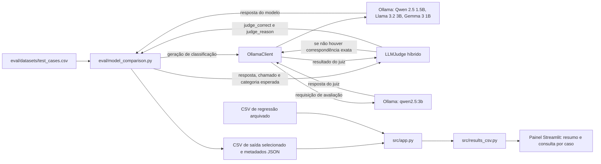

# Documentação técnica — T17

**Versão:** primeira versão para revisão
**Base:** branch `docs/t17-documentacao-e-evidencias`, no merge do PR #9 (`3b9e07c`).
**Escopo:** documentar a implementação encontrada nesta branch; não representa aprovação de critérios de avaliação pela equipe.

## 1. Visão geral e arquitetura

O projeto avalia modelos de linguagem na classificação de chamados de suporte em português. Há scripts de execução por linha de comando, CSVs históricos e um painel Streamlit para consultar resultados já gravados. O painel não executa modelos ao ser aberto.



No fluxo de comparação, `eval/model_comparison.py` lê a bateria de casos, solicita gerações ao Ollama e grava um registro por modelo e chamado. O campo `correct` registra a comparação textual feita pelo script; o parecer do `LLMJudge` é armazenado separadamente em `judge_correct` e `judge_reason`. O juiz primeiro compara textos normalizados em Python e chama `qwen2.5:3b` quando não encontra correspondência exata.

O painel lê os CSVs locais por meio de `src/results_csv.py`. Em **Resultados do projeto**, resume os modelos e permite consultar casos individuais. Em **Regressão de prompts**, abre um CSV arquivado. As duas opções são consultas aos arquivos existentes, não novas avaliações.

## 2. Instalação e execução

Os comandos abaixo são para Windows PowerShell, executados na pasta raiz do repositório. O [guia de instalação](../guia_instalacao.md) contém instruções adicionais para Docker e Ollama.

1. Instale Git e Python 3.12 ou superior. Clone o repositório e entre na pasta:

   ```powershell
   git clone https://github.com/GuihCastro/plataforma-avaliacao-llm.git
   cd plataforma-avaliacao-llm
   ```

2. Crie o ambiente virtual e instale as dependências declaradas em `requirements.txt`:

   ```powershell
   python -m venv .venv
   .\.venv\Scripts\python.exe -m pip install -r requirements.txt
   ```

3. Inicie o painel:

   ```powershell
   .\.venv\Scripts\python.exe -m streamlit run src\app.py
   ```

   O Streamlit informa o endereço local no terminal e normalmente abre o navegador. O painel consulta os CSVs empacotados no repositório; abrir os resultados existentes não requer Ollama.

4. Para executar avaliações novas, instale e inicie o Ollama e baixe os modelos antes da execução:

   ```powershell
   ollama pull qwen2.5:1.5b
   ollama pull llama3.2:3b
   ollama pull gemma3:1b
   ollama pull qwen2.5:3b
   ```

   O cliente usa `http://localhost:11434` por padrão. `OLLAMA_BASE_URL` permite indicar outro endereço. Veja as instruções de serviço e diagnóstico no [guia de instalação](../guia_instalacao.md).

## 3. Decisões de arquitetura observáveis

O código comprova as escolhas implementadas abaixo. Não há registro suficiente para atribuir motivações históricas ou afirmar que alternativas específicas foram formalmente avaliadas; esses pontos precisam de confirmação da equipe.

| Escolha observável | Contexto e evidência disponível | Alternativas documentadas |
|---|---|---|
| Invocar modelos por meio do Ollama e da API HTTP local. | `src/ollama_client.py` implementa `/api/generate`, lista os modelos aceitos e usa `localhost:11434` como padrão. | Não há comparação registrada com provedores hospedados; não se presume que tenham sido avaliados. |
| Persistir entradas e resultados em CSV. | `eval/model_comparison.py`, `eval/regression_test.py` e `src/app.py` leem ou gravam CSVs. | Não foi encontrada decisão registrada sobre banco de dados ou outro formato de persistência. |
| Usar uma avaliação híbrida no juiz. | `src/llm_judge.py` resolve correspondências após normalização em Python e chama `qwen2.5:3b` nos demais casos. | Uma avaliação exclusivamente por LLM não aparece como alternativa deliberada nos registros consultados. |
| Manter o painel como leitor de resultados gravados. | `src/app.py` carrega arquivos locais; o README informa que a consulta não inicia o Ollama. | Execução de modelos dentro do painel não está implementada; não há registro de decisão formal sobre essa alternativa. |

### Pendências de arquitetura

- **SQLite:** a persistência observada é em CSV; adoção de SQLite e seu esquema continuam pendentes de decisão.
- **Execução pelo painel:** o painel consulta arquivos, mas não inicia avaliações. A execução integrada pela interface continua pendente.
- **Versões dos prompts:** `src/results_csv.py` aceita a coluna opcional `prompt_version`, mas o CSV de resultados atual não a contém. A identificação/versionamento dos prompts das avaliações permanece pendente.

## 4. Referência da interface

O painel é iniciado por `streamlit run src\app.py` e oferece estas fontes:

| Fonte | Arquivo usado | O que consultar |
|---|---|---|
| **Resultados do projeto** | `eval/results/results_100_metrics.csv` | Resumo por modelo, incluindo casos, acertos, acurácia, latência e tokens. Escolha um modelo para ver os casos, a resposta e o parecer do juiz quando disponível. |
| **Regressão de prompts** | `eval/results/results_old/regression_results_prompt_comparison.csv` | Total de pares, acertos e acurácia do prompt original e degradado, variação em pontos percentuais, sinalização de queda/estabilidade/melhora e consulta das respostas de cada chamado. A tela identifica o experimento como arquivado. |
| **Demonstração JSON** | `eval/exemplos/exemplo-avaliacao.json` | Exemplo sintético conforme o contrato de avaliação. A demonstração é identificada na tela. |
| **Carregar arquivo** | Arquivo selecionado pelo usuário | Upload de JSON ou CSV; o painel valida os formatos reconhecidos e informa erros de leitura ou conteúdo inválido. |

No CSV de resultados, cada modelo pode ser selecionado para consultar seus registros. No CSV de regressão, selecione um chamado para ver categoria esperada e as duas respostas. Os nomes de modelos exibidos vêm dos dados carregados; essa tela não troca nem executa o modelo.

## 5. Dados e modelos

### Origem, tratamento e licenças

| Conjunto/componente | Origem e tratamento observados | Licença e pendências |
|---|---|---|
| Bateria `eval/datasets/test_cases.csv` | O arquivo tem 100 chamados. `eval/generate_test_cases.py` contém os exemplos usados para gerar o CSV; o registro da solicitação descreve a bateria como sintética e pede a preservação de exemplos anteriores. As categorias são Hardware, Software, Rede, Acesso, Instalação e Configuração. Não há fonte externa citada por linha. | O repositório inclui [`LICENSE`](../LICENSE), MIT, mas não explicita se a licença do projeto também cobre os dados. Confirmar autoria, procedência e licença/termos de reutilização da bateria antes de redistribuí-la. |
| Resultados dos modelos | `eval/model_comparison.py` envia os chamados ao Ollama, grava respostas, tempos e tokens; `correct` é calculado por comparação textual normalizada e os campos do juiz ficam separados. | Os resultados são derivados dos modelos, mas não há licença específica para os CSVs nem licença de saída identificada por modelo. Confirmar os termos dos modelos e o uso/redistribuição desses resultados. |
| CSV de regressão | `eval/regression_test.py` amostra 20 chamados com semente `42`, consulta `qwen2.5:1.5b` com prompt original e degradado e grava ambas as respostas e vereditos. O arquivo em `results_old` é a cópia arquivada consultada pelo painel. | Licença específica do dataset e das saídas não está registrada. Confirmar antes de redistribuição externa. |
| Revisão humana e calibração | `eval/human_review.py` grava vereditos humanos em CSV; os scripts de reavaliação acrescentam resultados e identificam a versão do juiz. `eval.calibration` calcula concordância a partir do CSV calibrado. | O repositório não registra nomes dos anotadores ou termos específicos para redistribuir essas avaliações. Confirmar consentimento, autoria e licença. |
| Modelos Ollama | Os nomes aparecem em `src/ollama_client.py` e nos scripts de execução; pesos não são versionados neste repositório. | A licença MIT do projeto não licencia os modelos externos. Licença e termos de uso de cada versão upstream ainda precisam ser identificados e verificados. |

### Bateria e comparação de modelos

`eval/datasets/test_cases.csv` contém 100 chamados distintos, distribuídos em seis categorias. `eval/results/results_100_metrics.csv` contém 300 linhas: 100 para cada um de `qwen2.5:1.5b`, `llama3.2:3b` e `gemma3:1b`. A contagem recalculada do campo `correct` nesse CSV é:

| Modelo | Acertos no CSV | Registros |
|---|---:|---:|
| `qwen2.5:1.5b` | 46 | 100 |
| `llama3.2:3b` | 24 | 100 |
| `gemma3:1b` | 32 | 100 |

Há uma divergência que não deve ser ocultada: [Métricas de consumo](Metricas_consumo.md) informa 49, 22 e 37 acertos; o CSV e a [análise de erros](analise_erros_classificacao.md) indicam 46, 24 e 32. Para esta documentação, os números da tabela acima foram conferidos diretamente no CSV; a reconciliação do relatório está pendente.

### Regressão arquivada e seleção futura

O arquivo `eval/results/results_old/regression_results_prompt_comparison.csv` contém 20 pares e 20 chamados distintos. Nele, o prompt original tem 10 acertos (50%) e o degradado tem 3 (15%), diferença de **−35 pontos percentuais**. Essa é uma amostra de uma execução arquivada, não uma decisão sobre qual bateria será usada na entrega.

A seção 5 do [registro de interações](../PROMPTS.md) atribui à T16 a escolha da bateria para o relatório e registra que a equipe ainda decidirá qual execução usar. Não trate os 20 pares arquivados como a bateria final selecionada.

### Revisão humana e calibração

`eval/results/human_review_30.csv` contém 30 linhas: 10 por modelo para os mesmos 10 chamados distintos. Logo, as 30 avaliações não representam 30 situações independentes. O arquivo calibrado, `eval/results/human_review_30_calibrated.csv`, preserva essa mesma distribuição. O resultado de concordância descrito em [Calibração do LLM Judge](relatorio_calibracao_judge.md) se aplica a essa amostra limitada.

`eval.calibration` apresenta uma lista dos CSVs calibrados disponíveis, permite escolher um arquivo interativamente e calcula concordância e Kappa lendo esse arquivo local. Esse cálculo não chama Ollama. É diferente de `eval.rejudge_results` e `eval.rejudge_human_review`, que passam respostas por `LLMJudge` e podem chamar `qwen2.5:3b` quando a comparação normalizada não resolve o caso.

## 6. Reprodução das avaliações

Execute os comandos na raiz do repositório, com as dependências instaladas. As avaliações que chamam modelos necessitam do Ollama em execução e dos modelos correspondentes baixados.

### Comparação dos três modelos

```powershell
.\.venv\Scripts\python.exe -m eval.model_comparison --output eval/results/comparison_nova.csv
```

O argumento `--output` é obrigatório e deve apontar para um CSV que ainda não exista. O script verifica previamente os três classificadores e o modelo `qwen2.5:3b`; se algum estiver indisponível, não inicia a bateria. São registrados 100 casos para cada classificador, com gravação incremental e um arquivo JSON de metadados ao lado do CSV. O arquivo histórico `eval/results/results_100_metrics.csv` não é substituído. O juiz híbrido mantém suas decisões em `judge_correct` e `judge_reason`, e as métricas das chamadas adicionais ao juiz ficam separadas das métricas de geração classificadora. Um `judge_correct` vazio indica que não houve veredito válido (por exemplo, JSON inválido); `false` indica um julgamento negativo válido, e `judge_error` registra falhas de avaliação. Uma resposta classificadora vazia é registrada como falha e não é enviada ao juiz.

### Regressão de prompts

```powershell
.\.venv\Scripts\python.exe -m eval.regression_test
```

O código seleciona 20 casos com semente `42`, consulta o modelo `qwen2.5:1.5b` com cada um dos dois prompts (40 gerações) e grava `eval/results/regression_results_prompt_comparison.csv`. Esse caminho de saída é diferente do CSV em `results_old` usado pelo painel; uma nova execução não atualiza automaticamente o arquivo arquivado. O relatório do experimento pode ser consultado em [Teste de Regressão de Prompt](Teste_regressao.md).

### Revisão humana e reavaliação do juiz

`human_review` é uma etapa interativa de anotação humana; `rejudge_results` e `rejudge_human_review` chamam o juiz e podem fazer requisições ao Ollama:

```powershell
.\.venv\Scripts\python.exe -m eval.rejudge_results
.\.venv\Scripts\python.exe -m eval.human_review
.\.venv\Scripts\python.exe -m eval.rejudge_human_review
```

Leia [Reavaliação das avaliações humanas](Reavaliacao_human_review.md) e [Calibração do LLM Judge](LLM_judge_calibracao.md) antes de executar essas etapas. Confira os caminhos de entrada e saída: os scripts geram ou substituem arquivos CSV.

### Cálculo local da calibração

```powershell
.\.venv\Scripts\python.exe -m eval.calibration
```

O programa pede que o usuário escolha um CSV calibrado em `eval/results` e calcula as métricas a partir dos campos existentes. Não precisa de Ollama nem reavalia as respostas.

## 7. Testes e integração contínua

Para validar as leituras, cálculos e interface sem executar modelos:

```powershell
.\.venv\Scripts\python.exe -m pytest -q tests/test_app.py tests/test_results_csv.py
```

Na verificação registrada nesta branch, o resultado foi **17 testes e 16 subtestes aprovados**. O histórico de execuções da T11 e seu último resultado estão em [PROMPTS.md](../PROMPTS.md).

O comando `.\.venv\Scripts\python.exe -m pytest -q` também inclui `tests/test_ollama_client.py`; o teste de geração bem-sucedida depende de um Ollama acessível e do modelo solicitado. A aprovação dos testes de painel/CSV não equivale a uma avaliação completa dos modelos.

Não foi localizado workflow de CI versionado, tag `v1.0` ou execução de Actions para ela. A evidência final exigida continua pendente: link direto para a execução verde correspondente à tag `v1.0` e captura de tela dessa execução. A quantidade de testes executados não substitui uma medição de cobertura; cobertura percentual ainda não foi medida.

O [`compose.yaml`](../compose.yaml) atual configura somente o serviço `testes`; o [`Dockerfile`](../Dockerfile) termina executando `python -m pytest -v`. Portanto, `docker compose up` não inicia o painel neste estado. A integração do Compose com um serviço Streamlit, incluindo porta e comando de inicialização, permanece pendente.

## 8. Segurança, privacidade e limitações

- O cliente aponta para o Ollama local por padrão. Se `OLLAMA_BASE_URL` for configurado para outro host, os prompts e chamados enviados ao modelo serão encaminhados a esse host; confirme que ele é autorizado para os dados usados.
- Os CSVs contêm texto de chamados, respostas e pareceres. Não inclua dados pessoais ou confidenciais reais sem autorização e revisão; o repositório não demonstra um mecanismo automático de anonimização.
- O cliente não mostra configuração de autenticação para a API Ollama. Não exponha essa API ou o painel a redes não confiáveis sem controles adicionais.
- A métrica `correct` da comparação de modelos é baseada em igualdade textual após normalização simples no script; ela pode classificar como erro uma resposta semanticamente adequada com texto diferente. O resultado do juiz é armazenado em campos separados.
- As amostras arquivadas são limitadas. Os 20 pares da regressão são uma execução específica; os 30 registros de revisão humana são apenas 10 chamados repetidos entre três modelos. Não generalize esses números para todos os chamados.
- Os relatórios existentes não são todos consistentes com os CSVs. Verifique a origem dos números e registre a reconciliação antes de usá-los como resultados finais.
- Não há vídeo de demonstração de 3–5 minutos, em tela inteira, mostrando `docker compose up` e o fluxo principal; os logs completos da avaliação e a CI verde com link e captura da tag `v1.0` também não foram identificados. O Compose precisa ser integrado ao painel antes de gravar esse fluxo. Uma captura real da interface, a confirmação das decisões arquiteturais, a origem/licença dos dados e as licenças dos modelos também precisam ser anexadas ou confirmadas.
- SQLite, execução de avaliações pelo painel e identificação das versões dos prompts continuam pendentes; consulte a lista de pendências de arquitetura acima.
- Três falhas analisadas estão descritas em [Analise_erros.md](Analise_erros.md): [Qwen — webcam classificada como instalação](https://github.com/GuihCastro/plataforma-avaliacao-llm/blob/main/docs/Analise_erros.md#L11), [Qwen — faixa preta no monitor classificada como instalação](https://github.com/GuihCastro/plataforma-avaliacao-llm/blob/main/docs/Analise_erros.md#L20) e [Llama — conexão cabeada classificada como acesso](https://github.com/GuihCastro/plataforma-avaliacao-llm/blob/main/docs/Analise_erros.md#L29).

## 9. Manual do usuário

### Abrir o painel no Windows

1. Abra o PowerShell na pasta onde deseja guardar o projeto e clone o repositório:

   ```powershell
   git clone https://github.com/GuihCastro/plataforma-avaliacao-llm.git
   cd plataforma-avaliacao-llm
   ```

2. Crie e prepare o ambiente Python:

   ```powershell
   python -m venv .venv
   .\.venv\Scripts\python.exe -m pip install -r requirements.txt
   ```

3. Inicie o painel:

   ```powershell
   .\.venv\Scripts\python.exe -m streamlit run src\app.py
   ```

4. Abra o endereço local informado pelo Streamlit, se o navegador não abrir automaticamente.

### Consultar resultados dos modelos

1. Em **Fonte dos resultados**, selecione **Resultados do projeto**.
2. Compare as linhas de resumo para ver casos, acertos, acurácia, latência e tokens.
3. Em **Modelo para consultar**, escolha o modelo cujos chamados deseja inspecionar.
4. Na lista de casos, selecione o registro para consultar o chamado, a resposta gravada e o parecer do juiz quando disponível.

Essa consulta usa resultados gravados e não inicia o Ollama.

### Consultar a regressão arquivada

1. Em **Fonte dos resultados**, selecione **Regressão de prompts**.
2. Confirme que a tela identifica o experimento como arquivado e mostra o CSV de origem.
3. Compare as métricas do prompt original e do degradado. Na versão documentada, a amostra mostra 20 pares, 50%, 15% e −35 p.p.
4. Em **Selecionar chamado**, escolha um registro para comparar categoria esperada e respostas dos dois prompts.

O resultado exibido pertence ao CSV arquivado; não é uma execução nova nem a seleção definitiva da bateria da T16.
