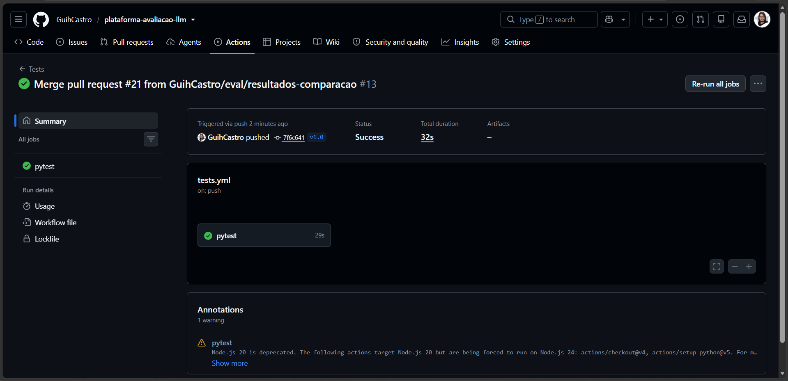
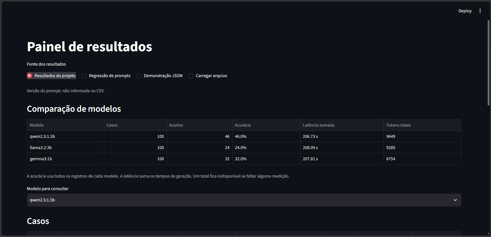
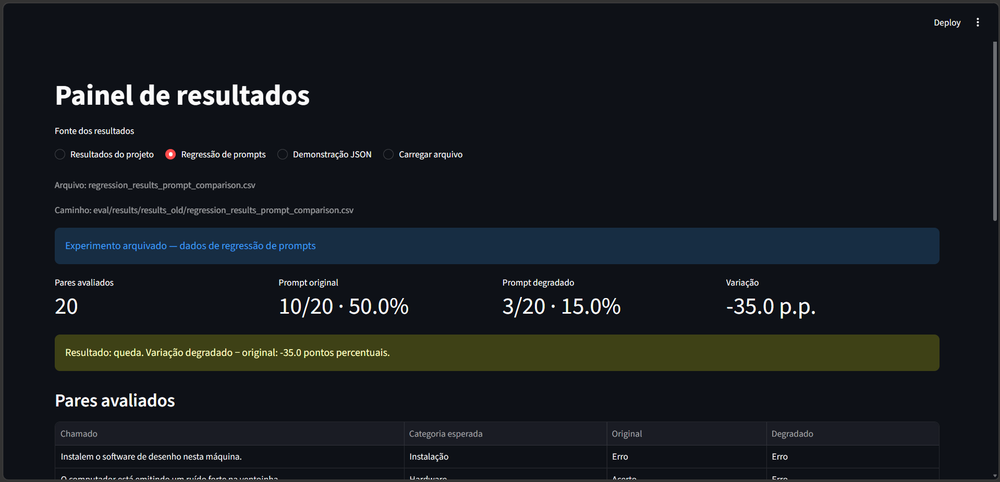
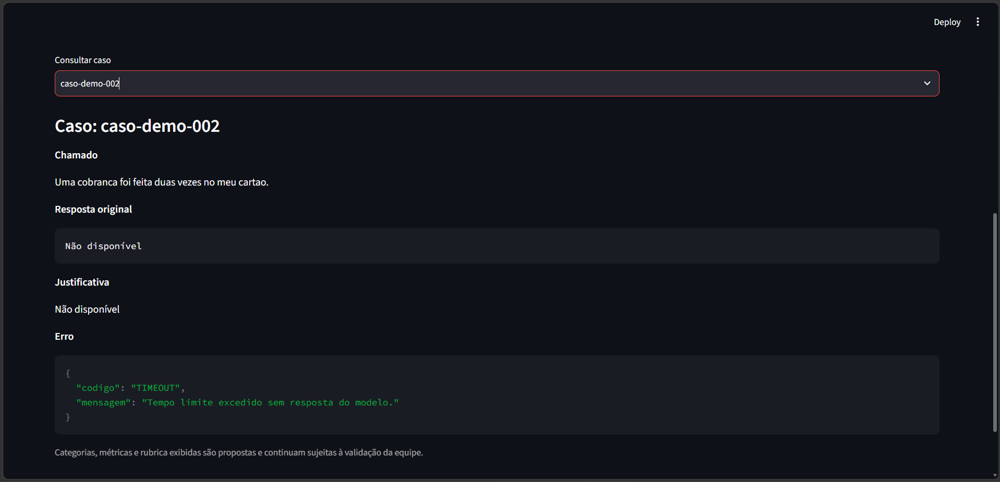

# Índice de evidências — T17

Este índice liga as afirmações da documentação técnica às fontes do repositório e indica como conferi-las. A documentação é uma primeira versão: observações marcadas como pendentes precisam de confirmação ou de evidência anexada.

## Afirmações verificadas

| Afirmação | Fonte | Como conferir |
|---|---|---|
| A validação manual de inicialização do painel pelo Docker Compose foi realizada em 23/11/2026 por Guilherme. | [`docker-compose-inicializacao.txt`](docker-compose-inicializacao.txt), [`docker-compose-status.txt`](docker-compose-status.txt). | `docker-compose-inicializacao.txt` contém a saída dos serviços obtida com `docker compose logs --no-color --timestamps`; não contém as etapas de construção da imagem. A conclusão do build foi conferida separadamente na saída de `docker compose up --build` enviada por Guilherme ao ChatGPT. O status mostra `app` e `ollama` em execução. Guilherme abriu e conferiu no `localhost:8501` as telas de resultados dos modelos, regressão arquivada e demonstração JSON. O ChatGPT conferiu as saídas e capturas enviadas. Essa validação não incluiu inferência nem teste da comunicação entre o backend e o Ollama. |
| A execução real de regressão `20261123-213619` avaliou 20 chamados distintos com `qwen2.5:1.5b`: 10 acertos originais, zero degradados e queda de 50 p.p. | [Relatório da execução](../docs/regressao-20261123-213619.md), [CSV](../eval/results/execucoes/20261123-213619/regressao.csv), [log](regressao-20261123-213619.txt). | Recalcular as contagens no CSV. O relatório documenta configuração, horários em Brasília, comparação exata normalizada sem juiz LLM e os limites desta rodada específica. |
| A branch de documentação parte do merge do PR #9 (`3b9e07c`). | Histórico Git local; lista de arquivos alterados no merge. | Na raiz, execute `git log -1 --oneline --decorate`, `git show --stat 3b9e07c` e `git merge-base --is-ancestor 3b9e07c HEAD`. Nesta revisão, o último comando terminou com código 0. |
| A CI da tag `v1.0` foi aprovada no commit `7f6c641a3d487979b38bfc02f510acd10d448ace`. | [Execução do GitHub Actions](https://github.com/GuihCastro/plataforma-avaliacao-llm/actions/runs/45918634750), [captura manual](imagens/ci-v1.0.png). | Os detalhes da execução registram branch `v1.0`, o SHA completo e conclusão `success`. O job `pytest` também concluiu com sucesso; seus logs mostram `43 passed, 16 subtests passed in 3.89s`. Guilherme fez a captura manualmente; o ChatGPT conferiu visualmente na captura a tag `v1.0` e o status `Success`. |
| O dataset contém 100 chamados e seis categorias; sua distribuição é 17, 17, 17, 17, 16 e 16. | [`eval/datasets/test_cases.csv`](../eval/datasets/test_cases.csv), [`eval/generate_test_cases.py`](../eval/generate_test_cases.py), [`docs/relatorio_qualidade_dados.md`](../docs/relatorio_qualidade_dados.md). | Conte as linhas de dados e agrupe por `expected`; confira também as asserções de quantidade e distribuição no gerador. |
| `results_100_metrics.csv` tem 300 registros, 100 por modelo, para 100 chamados distintos. | [`eval/results/results_100_metrics.csv`](../eval/results/results_100_metrics.csv), [`eval/model_comparison.py`](../eval/model_comparison.py). | Ler o CSV com `csv.DictReader`; contar as linhas, agrupar por `model` e contar valores distintos de `input`. Nesta rodada foram obtidos 100 / 100 / 100 e 100 chamados. |
| Os acertos do CSV atual são 46, 24 e 32 para Qwen, Llama e Gemma, respectivamente. | [`eval/results/results_100_metrics.csv`](../eval/results/results_100_metrics.csv), [`docs/analise_erros_classificacao.md`](../docs/analise_erros_classificacao.md). | Contar linhas com `correct=true` por `model`; conferir com a análise de erros. O arquivo [`docs/Metricas_consumo.md`](../docs/Metricas_consumo.md) diverge (49, 22, 37) e precisa ser reconciliado antes de citar esses valores como definitivos. |
| O CSV de regressão arquivado contém 20 pares distintos, 10 acertos originais e 3 degradados, diferença de −35 p.p. | [`eval/results/results_old/regression_results_prompt_comparison.csv`](../eval/results/results_old/regression_results_prompt_comparison.csv), [`tests/test_results_csv.py`](../tests/test_results_csv.py), [`src/results_csv.py`](../src/results_csv.py). | Contar linhas, chamados distintos e valores `true` em `original_correct` e `degraded_correct`; calcular `100 * (3/20 - 10/20)`. Os testes de regressão conferem esses números. |
| A regressão arquivada não deve ser confundida com a execução futura ou com a bateria que a equipe escolherá para o relatório. | [`PROMPTS.md`](../PROMPTS.md), seções da T11; [`eval/regression_test.py`](../eval/regression_test.py). | A preparação da T11 registra a decisão da equipe como pendente. O script atual grava em `eval/results/regression_results_prompt_comparison.csv`, fora de `results_old`. |
| O relatório publicado para a regressão diverge do CSV arquivado: relata 9 e 3 acertos, enquanto o CSV contém 10 e 3. | [`docs/Teste_regressao.md`](../docs/Teste_regressao.md), [`eval/results/results_old/regression_results_prompt_comparison.csv`](../eval/results/results_old/regression_results_prompt_comparison.csv), [`PROMPTS.md`](../PROMPTS.md). | Comparar a tabela do relatório com uma contagem das colunas de veredito no arquivo arquivado. O histórico da T11 já sinaliza a discrepância. |
| A revisão humana tem 30 linhas, 10 por modelo, mas apenas 10 chamados distintos repetidos entre os modelos. | [`eval/results/human_review_30.csv`](../eval/results/human_review_30.csv), [`eval/results/human_review_30_calibrated.csv`](../eval/results/human_review_30_calibrated.csv), [`docs/LLM_judge_calibracao.md`](../docs/LLM_judge_calibracao.md). | Contar linhas por `model` e valores distintos de `input`; ambos os CSVs apresentam 10 linhas por modelo e 10 entradas distintas. Não descrever como 30 chamados independentes. |
| O painel e o leitor CSV têm testes locais registrados na T11. | [`tests/test_app.py`](../tests/test_app.py), [`tests/test_results_csv.py`](../tests/test_results_csv.py), [`PROMPTS.md`](../PROMPTS.md), seção 5. | O registro da T11 contém o comando `.\.venv\Scripts\python.exe -m pytest -q tests/test_app.py tests/test_results_csv.py` e a saída reportada de 17 testes e 16 subtestes aprovados. A mesma execução foi repetida nesta rodada. |
| O teste do cliente Ollama inclui uma geração de sucesso dependente do serviço local. | [`tests/test_ollama_client.py`](../tests/test_ollama_client.py), [`src/ollama_client.py`](../src/ollama_client.py). | Inspecione `test_ollama_client_success` e execute-o apenas com Ollama e o modelo configurados. Os testes focados de painel/CSV não fazem chamadas a modelos. |
| O código documentado usa Streamlit, CSVs e Ollama HTTP; o juiz aplica comparação direta antes da chamada ao modelo. | [`src/app.py`](../src/app.py), [`src/results_csv.py`](../src/results_csv.py), [`src/ollama_client.py`](../src/ollama_client.py), [`src/llm_judge.py`](../src/llm_judge.py). | Inspecione as fontes e compare os nomes de arquivos padrão e as chamadas mencionadas na documentação. |
| `eval.calibration` seleciona um CSV calibrado localmente e calcula concordância sem chamar modelos. | [`eval/calibration.py`](../eval/calibration.py), [`eval/rejudge_results.py`](../eval/rejudge_results.py), [`eval/rejudge_human_review.py`](../eval/rejudge_human_review.py). | `calibration.py` usa `input()` para escolher arquivo e lê CSV; não importa `LLMJudge`/`OllamaClient`. Os scripts `rejudge_*` usam `LLMJudge`, que pode chamar `qwen2.5:3b` via Ollama. |
| As origens e os tratamentos documentados distinguem bateria, resultados, regressão e revisão humana. | [`eval/generate_test_cases.py`](../eval/generate_test_cases.py), [`eval/model_comparison.py`](../eval/model_comparison.py), [`eval/regression_test.py`](../eval/regression_test.py), [`eval/human_review.py`](../eval/human_review.py), [`PROMPTS.md`](../PROMPTS.md). | Compare o código e o histórico de solicitações; autoria/fonte externa por registro não é declarada e continua pendente de confirmação. |
| A licença MIT do repositório não prova a licença dos dados nem dos pesos externos. | [`LICENSE`](../LICENSE), arquivos CSV e [`src/ollama_client.py`](../src/ollama_client.py). | A licença do repositório é MIT; não há licença individual para CSVs/modelos nem versões dos pesos registradas. Verificar os termos upstream e o escopo dos dados antes de redistribuir. |
| A cobertura de testes ainda não foi medida. | [`tests/`](../tests), [`PROMPTS.md`](../PROMPTS.md). | O histórico registra quantidade de testes, não porcentagem de cobertura; não foi encontrado relatório gerado por ferramenta de coverage. |
| SQLite, avaliação disparada pelo painel e identificação/versionamento dos prompts são pendências. | [`src/app.py`](../src/app.py), [`src/results_csv.py`](../src/results_csv.py), [`eval/results/results_100_metrics.csv`](../eval/results/results_100_metrics.csv). | O painel lê arquivos locais; não há uso de SQLite nem chamada de execução da avaliação. Parser admite `prompt_version` opcional, mas o CSV atual não tem essa coluna. |

### Resultado da verificação dos CSVs nesta rodada

Contagens calculadas a partir dos arquivos locais:

- Dataset: 100 linhas e 100 mensagens distintas.
- Resultados de modelos: 300 linhas, 100 por modelo; 100 mensagens distintas; acertos 46 / 24 / 32.
- Regressão arquivada: 20 linhas e mensagens distintas; 10 acertos originais e 3 degradados.
- Revisão humana e versão calibrada: 30 linhas cada; 10 por modelo e 10 mensagens distintas.

Essas contagens verificam a estrutura e os campos registrados; não reexecutam os modelos nem validam manualmente cada classificação.

## Evidências pendentes

| Evidência a obter | Situação nesta branch |
|---|---|
| Vídeo de 3–5 minutos, com a tela inteira, iniciando o projeto por `docker compose up` e percorrendo o fluxo principal. | A gravação real da demonstração está disponível em [`videos/video-demonstracao.mp4`](videos/video-demonstracao.mp4). Sua duração é 1 min 42,891 s (aproximadamente 1 min 43 s), sem narração audível. Guilherme decidiu manter esta versão; ela não atende ao intervalo solicitado de 3–5 minutos. |
| Comparação completa dos três modelos. | A comparação real `20261126-200844` está documentada em [`docs/comparacao-20261126-200844.md`](../docs/comparacao-20261126-200844.md), com os resultados em [`comparacao.csv`](../eval/results/execucoes/20261126-200844/comparacao.csv), metadados e log original. |
| Logs completos da comparação dos três modelos. | O [log original da comparação `20261126-200844`](comparacao-20261126-200844.txt) registra os 100 casos por cada um dos três modelos. O [log da regressão `20261123-213619`](regressao-20261123-213619.txt) permanece evidência separada de uma execução apenas do `qwen2.5:1.5b`. Os arquivos [`docker-compose-inicializacao.txt`](docker-compose-inicializacao.txt) e [`docker-compose-status.txt`](docker-compose-status.txt) registram a inicialização dos serviços, não inferência ou regressão. |
| Confirmação da bateria que a equipe escolherá para o relatório. | O CSV de 20 pares é arquivado e a T11 registra a decisão como pendente; obter decisão explícita da equipe e identificador/versão da bateria. |
| Confirmação das escolhas arquiteturais além das capturas da interface. | Foram adicionadas três capturas manuais feitas por Guilherme e conferidas visualmente no ChatGPT. As motivações e alternativas arquiteturais ainda não constam nos registros e permanecem pendentes de confirmação pela equipe. |
| Reconciliação dos números dos relatórios com os CSVs. | `Metricas_consumo.md` diverge dos resultados em CSV; `Teste_regressao.md` diverge do CSV arquivado. Definir a fonte da versão final e corrigir ou contextualizar os relatórios após aprovação. |
| Licenças específicas dos conjuntos de dados e versões dos modelos. | [`LICENSE`](../LICENSE) declara MIT para o projeto; não foi encontrada licença por dataset nem referência com versão/digest e licença dos modelos usados. Verificar origem/termos de cada fonte antes da publicação. |

## Evidência de CI aprovada — tag `v1.0`

- **Execução:** [GitHub Actions — run 45918634750](https://github.com/GuihCastro/plataforma-avaliacao-llm/actions/runs/45918634750)
- **Commit avaliado:** `7f6c641a3d487979b38bfc02f510acd10d448ace`
- **Resultado:** `Success` (conclusão `success`); job `pytest` concluído com sucesso.
- **Testes nos logs:** `43 passed, 16 subtests passed in 3.89s`.
- **Captura:** [evidencias/imagens/ci-v1.0.png](imagens/ci-v1.0.png). Guilherme fez a captura manualmente e o ChatGPT conferiu visualmente a tag `v1.0` e o status `Success`.

[](imagens/ci-v1.0.png)

## Execução real de regressão — 20261123-213619

- [Relatório da execução](../docs/regressao-20261123-213619.md)
- [CSV de resultados](../eval/results/execucoes/20261123-213619/regressao.csv)
- [Log da execução](regressao-20261123-213619.txt)

Esta execução real e seus resultados são distintos da [regressão arquivada exibida pelo painel](../eval/results/results_old/regression_results_prompt_comparison.csv). O painel continua exibindo o experimento arquivado; não se deve interpretar sua captura como a execução `20261123-213619`.

## Comparação real — 20261126-200844

- [Relatório da comparação](../docs/comparacao-20261126-200844.md)
- [CSV original de resultados](../eval/results/execucoes/20261126-200844/comparacao.csv)
- [Metadados originais](../eval/results/execucoes/20261126-200844/comparacao.csv.metadata.json)
- [Log original em UTF-16](comparacao-20261126-200844.txt)

Os três modelos avaliaram os mesmos 100 chamados, totalizando 300 registros e 52/20/38 acertos. Os arquivos originais foram preservados como obtidos. Esta comparação não altera os resultados históricos nem o painel existente. A pendência de CI verde na tag `v1.0` permanece inalterada.

## Gravação da demonstração

[Vídeo da demonstração](videos/video-demonstracao.mp4)

Esta é uma gravação real da demonstração, compactada pelo ChatGPT. A duração registrada nos metadados do MP4 é de 1 min 42,891 s (aproximadamente 1 min 43 s). Não há narração audível. Guilherme decidiu manter esta versão, embora sua duração não atenda ao intervalo solicitado de 3–5 minutos.

## Capturas manuais da interface

As três capturas abaixo foram feitas manualmente por Guilherme Henrique de Castro e conferidas visualmente no ChatGPT. Elas documentam a interface nesta etapa; não reexecutam modelos nem demonstram uma nova execução dos modelos.

### Painel de comparação dos modelos

[](imagens/painel-modelos.png)

Captura manual do painel com a comparação dos resultados disponíveis. A imagem apresenta dados já registrados no projeto e não comprova uma execução manual ou automática nesta etapa.

### Regressão arquivada

[](imagens/painel-regressao.png)

Captura manual do painel na opção de regressão. Os dados exibidos correspondem ao experimento arquivado em [`eval/results/results_old/regression_results_prompt_comparison.csv`](../eval/results/results_old/regression_results_prompt_comparison.csv); não representam uma nova execução da regressão.

### Demonstração sintética da falha TIMEOUT

[](imagens/painel-falha.png)

Captura manual do painel apresentando dados sintéticos com uma falha `TIMEOUT`. A imagem é uma demonstração da interface e não indica que um modelo real tenha sido executado nesta etapa.

## Falhas analisadas e contribuições/revisões do grupo

### Falhas

O relatório [`docs/Analise_erros.md`](../docs/Analise_erros.md) descreve quatro casos individuais. Links diretos para três deles:

- [Caso 1 — Qwen 2.5 1.5B: webcam classificada como Instalação](https://github.com/GuihCastro/plataforma-avaliacao-llm/blob/main/docs/Analise_erros.md#L11).
- [Caso 2 — Qwen 2.5 1.5B: monitor com faixa preta classificado como Instalação](https://github.com/GuihCastro/plataforma-avaliacao-llm/blob/main/docs/Analise_erros.md#L20).
- [Caso 3 — Llama 3.2 3B: conexão cabeada classificada como Acesso](https://github.com/GuihCastro/plataforma-avaliacao-llm/blob/main/docs/Analise_erros.md#L29).
- [Caso 4 — Llama 3.2 3B: Wi-Fi ausente classificado como Configuração](https://github.com/GuihCastro/plataforma-avaliacao-llm/blob/main/docs/Analise_erros.md#L38).

### Contribuições e revisões

Links públicos de contribuições e revisões encontrados no histórico do repositório:

| Registro | Contribuição/revisão verificável |
|---|---|
| [PR #4 — implementação da plataforma](https://github.com/GuihCastro/plataforma-avaliacao-llm/pull/4) | Contribuição de Hugo (`HugoM-Git`). |
| [PR #5 — relatório de qualidade dos dados](https://github.com/GuihCastro/plataforma-avaliacao-llm/pull/5) | Contribuição de Johnny (`Jviudes-hub`). |
| [PR #7 — calibração do Judge e análise de erros](https://github.com/GuihCastro/plataforma-avaliacao-llm/pull/7) | Contribuição de Johnny; [revisão aprovada por Guilherme](https://github.com/GuihCastro/plataforma-avaliacao-llm/pull/7#pullrequestreview-5966642984). |
| [PR #8 — comparação dos resultados no painel](https://github.com/GuihCastro/plataforma-avaliacao-llm/pull/8) | Contribuição de Guilherme. A consulta de reviews deste PR não retornou revisão registrada. |
| [PR #9 — regressão de prompts no painel](https://github.com/GuihCastro/plataforma-avaliacao-llm/pull/9) | Contribuição de Guilherme. A consulta de reviews deste PR não retornou revisão registrada. |

## Verificações da versão inicial da T17

Na raiz do repositório:

```powershell
.\.venv\Scripts\python.exe -m pytest -q tests/test_app.py tests/test_results_csv.py
```

Saída final observada: `17 passed, 16 subtests passed in 4.65s`.

Também foram contadas as linhas e distribuições dos CSVs com `csv.DictReader` no Python da `.venv`, e conferido o histórico Git para confirmar o merge do PR #9. Não foram executados Ollama, a comparação completa de modelos, a CI ou uma captura de vídeo.

## Revisão de evidências em 19/11/2026

- `git merge-base --is-ancestor 3b9e07c HEAD` terminou com código 0.
- A conferência automática dos links relativos dos documentos encontrou 61 destinos e nenhum link quebrado.
- `git diff --check HEAD` não apontou problemas de whitespace.
- Na revisão de 19/11/2026, anterior à execução de CI e à captura documentadas acima, a consulta GitHub retornou zero workflows e zero execuções de Actions filtradas pela branch/tag `v1.0`; a consulta da tag não encontrou commit. Naquele momento não havia link de execução verde ou captura anexados; esta é uma observação histórica, superada pela evidência atual da tag `v1.0`.
- A verificação foi documental: não foram reexecutados testes, modelos ou avaliações nesta revisão.
